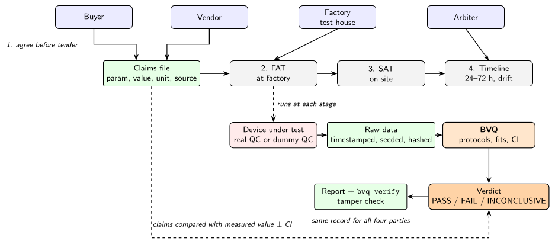

# Concept of operations

Source: [diagrams/conops.tex](diagrams/conops.tex).

## Steps

1. **Agree.** Buyer and vendor write the claims file together, before the tender. Each claim: parameter, comparator, value, unit, source.
2. **FAT.** Factory test house runs the suite at the vendor site. Same suite, same claims.
3. **SAT.** Same suite after delivery, at the buyer site.
4. **Timeline.** 24 to 72 hours. Cheap battery every 10 to 30 minutes. Two modes: no recalibration (stability) and vendor recalibration on (delivered performance).
5. **Verdict.** Each claim: measured value with CI against declared value. PASS, FAIL or INCONCLUSIVE.
6. **Report.** Raw data timestamped, seeded, hashed. Arbiter runs `bvq verify`. Tamper gives exit code 3.

## Verdict rules

- PASS: CI clearly meets claim.
- FAIL: CI clearly violates claim.
- INCONCLUSIVE: no uncertainty, claim not measured, fewer than 3 qubits for a population claim, unit mismatch, failed fit, wrong mode.
- Device verdict: any FAIL means FAIL. Else any INCONCLUSIVE means INCONCLUSIVE. Else PASS.

## Roles

| Role | Does |
|---|---|
| Buyer | Writes claims, owns the record |
| Vendor | Writes claims, runs recalibration, delivers raw data |
| Factory test house | Runs FAT before delivery |
| Arbiter | Runs timeline, `verify`, settles disputes |

## Dummy QC use

Before a real tender, run the suite on the dummy QC with a known noise model.
Does it PASS the honest device? Does it FAIL every injected fault? If not, fix the suite, not the device.
See [failure modes](FAILURE_MODES.md).

## Limits

- Circuit front-end (planned): Clifford circuits with Pauli noise, Monte Carlo over shots, noise parameters change with time.
- Coherent errors become Pauli mixtures. No non-Clifford workloads there.
- Report states these limits every time.
