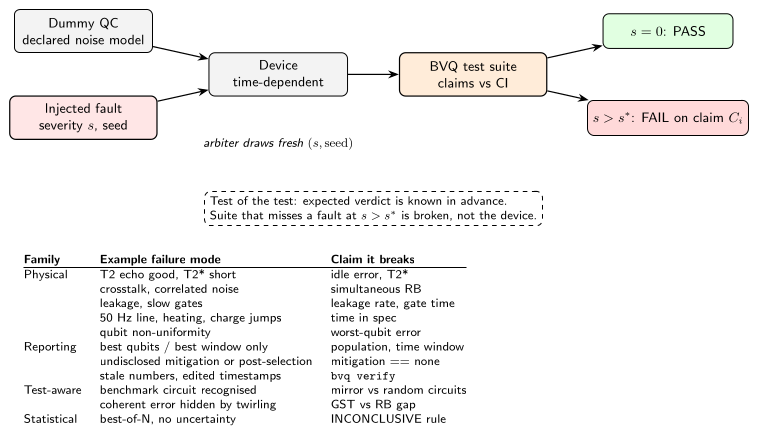

# Failure-mode gallery

Source: [diagrams/fault_testing.tex](diagrams/fault_testing.tex).

## Idea

1. Take dummy QC with declared noise model.
2. Inject one fault. Set severity `s` and seed.
3. Run the suite.
4. Expected verdict is known in advance. `s = 0` must PASS. `s` above threshold must FAIL on a named claim.
5. Suite that misses the fault is broken. Not the device.

Everything is parametric. Arbiter draws fresh `(s, seed)`. Gallery is public on purpose: tuning a device to pass all of it means a more robust device.

## Gallery (draft, IDs not frozen)

Status: planned. None implemented yet.

### Physical

| Failure mode | Mechanism | Claim it should break |
|---|---|---|
| T2 good, T2\* short | Echo hides slow noise | Idle error, T2\* |
| Crosstalk | Neighbour drive shifts qubit | Simultaneous RB vs isolated RB |
| Correlated noise | Shared noise source on chain | Population claims, correlated errors |
| Leakage | Population leaves computational space | Leakage rate |
| Non-uniform qubits | Some qubits much worse | Worst-qubit and median claims |
| Mains line (50 Hz) | Spectral line in frequency | Time in spec, line test |
| Heating | Drive duty cycle shifts frequency | Time in spec at realistic duty cycle |
| Slow gates | Gate time above spec | Gate-time claim, idle error |
| Charge jumps | Sudden frequency steps | Time to violation |
| Sensor drift | Readout working point wanders | Readout fidelity over time |
| Non-Markovian noise | Parameters change between shots | RB fit quality |

### Reporting and selection

| Failure mode | Mechanism | Claim it should break |
|---|---|---|
| Best qubits only | Subset quoted as device | Population claims |
| Best time window only | Quote right after calibration | Time-in-spec claim |
| Calibrate just before test | Hide drift | Timeline mode |
| Hidden mitigation | Readout correction or mitigation not disclosed | mitigation == none |
| Post-selection | Bad shots dropped | Shot-count consistency |
| Easy lengths only | RB at short depth | Required length set |
| Stale numbers | Old calibration quoted as measured | Timestamp and verify |
| Edited timestamps | Order or time changed | `bvq verify` |

### Test-aware

| Failure mode | Mechanism | Claim it should break |
|---|---|---|
| Benchmark circuit recognised | Device behaves better on known circuits | Mirror vs random circuits |
| Warm-up before run | Pre-heat to stable point | Cold-start timeline |
| Coherent error hidden by twirling | RB under-reports | GST vs RB gap |
| Readout masks leakage | Leaked state read as 1 | Leakage test |

### Statistical

| Failure mode | Mechanism | Rule |
|---|---|---|
| Best-of-N | Report best run | Median over runs, fixed seeds |
| No uncertainty | Point value only | INCONCLUSIVE |
| Cherry-picked seeds | Choose lucky seed | Seeds fixed in record |

## Variational / hybrid (planned)

- Optimizer and seeds fixed. Median, not best-of-N.
- Noiseless baseline. Report the gap.
- Drift logged per iteration.
- Known-answer circuits interleaved.

## Contributing a failure mode

Each entry needs: ID, mechanism, claims violated, which tests detect it, expected verdict, severity range, source.
